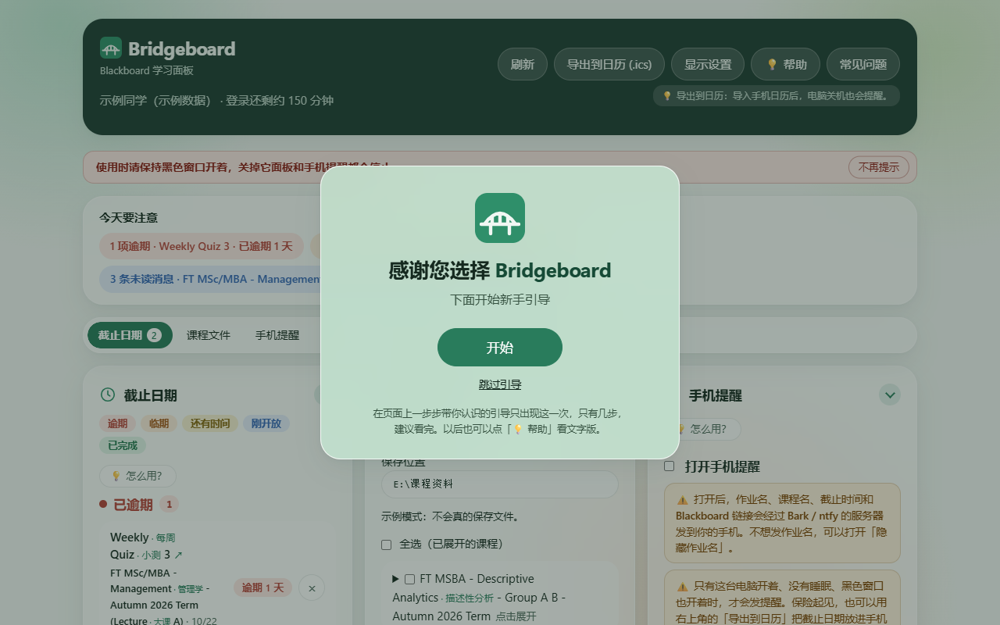
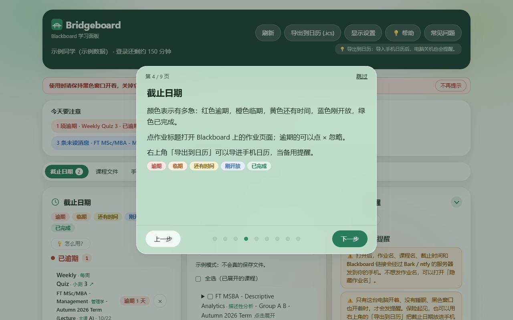

<div align="center">


# Bridgeboard

<h3 align="center">你的专属 Blackboard 看板<br>Your personal Blackboard dashboard</h3>

<h4 align="center">截止日期提醒 · 课程文件一键下载 · 手机提醒 · 待办清单 · 课程消息、公告和成绩，一个页面全看到<br>Deadlines, course file downloads, phone alerts, a to-do list, messages, announcements and grades, all on one page</h4>

[](https://github.com/HeathTeng/Bridgeboard/releases/latest)

[](LICENSE)

### [⬇ 下载 Windows 版 / Download for Windows](https://github.com/HeathTeng/Bridgeboard/releases/latest/download/Bridgeboard-Windows.zip)

免费 · 解压后双击 `start.bat` · 不用安装任何东西<br>
[官网 getboundly.com](https://getboundly.com) · [常见问题](docs/FAQ.md) · [意见反馈](mailto:feedback@getboundly.com)


</div>

> 🔒 **数据只在你的电脑上。** Bridgeboard 在你自己的电脑上运行，登录信息和课程数据不会发给我们或任何第三方（你自己打开的手机提醒是唯一例外）。它不是学校的官方工具，只读取，不会替你提交任何东西。<br>
> **Your data stays on your computer.** Your login and course data never leave it (phone alerts, if you turn them on, are the one exception). Not an official school tool; read-only.

## 它能做什么 · What it does

| | 功能 | What it does |
| --- | --- | --- |
| ⏰ | **五色截止提醒**：所有课程的作业按逾期、临期、还有时间、刚开放、已完成排好 | Deadlines from every course in five colours |
| 🙈 | **逾期作业可以忽略**：点 × 不再提醒，6 秒内可撤销，随时能在「已忽略」里恢复；只记在你的电脑上 | Stop reminders for an overdue assignment, with undo and restore |
| ↗ | **直接打开 Blackboard**：作业和课程消息旁边的「在 Blackboard 打开 ↗」直接打开那一项；公告、成绩和课程文件的「打开课程主页 ↗」打开课程首页 | Buttons open the assignment or message in Blackboard, or the course home where Blackboard gives no page address |
| 📁 | **课程文件一键下载**：勾选课程，选文件夹（U 盘也行），按课程整理；可导出给 AI 用的文字版 | Download course files sorted by course, with text copies for AI tools |
| 🔔 | **手机提醒**：iPhone 用 Bark，安卓用 ntfy；默认关闭，测试成功才会发 | Opt-in phone alerts through Bark (iPhone) or ntfy (Android) |
| ✅ | **清单**：作业自动加入，交了自动打勾；也能写自己的待办 | A checklist that fills and ticks itself, plus your own to-dos |
| 💬 | **课程消息**：各门课的消息集中在一处，未读标出来 | Course messages from every course in one list |
| 📢 | **公告和成绩**：所有课程的公告和成绩一起看 | Announcements and grades across courses |
| 📅 | **导出到日历**：导入手机日历，电脑关机也会提醒 | Export deadlines to your phone's calendar |
| 💡 | **新手引导和帮助**：第一次打开会在页面上一步步带你认识各个功能；之后随时点「💡 帮助」再看，「常见问题」可以搜索 | A first-run walk-through, a 💡 help button and a searchable FAQ |
| 🔒 | **只读，不改 Blackboard**：只读取，不交作业、不做测验，连「已读」都不会替你标 | Read-only: it never changes anything in Blackboard, not even "read" |

<p align="center">
  
  
</p>

适用于使用 **Blackboard Learn Ultra** 的学校（登录后网址里有 `/ultra`）。 · Works with schools on Blackboard Learn Ultra.

## 三步上手 · Get started

1. **下载** [`Bridgeboard-Windows.zip`](https://github.com/HeathTeng/Bridgeboard/releases/latest/download/Bridgeboard-Windows.zip)。浏览器说「不常下载」时点「保留」。
2. **先解压**：右键压缩包 →「全部解压缩」，放到任意文件夹或 U 盘。直接在压缩包里双击是用不了的。
3. **双击 `start.bat`**：会出现一个黑色窗口（**用的时候别关**），浏览器自动打开面板。Windows 提示「已保护你的电脑」时，点「更多信息」→「仍要运行」。

然后填入学校的 Blackboard 网址，点 **连接 Blackboard**，在弹出的窗口里像平时一样登录。学校问 **「保持登录状态？」（Stay signed in?）时选「是」**，以后基本不用再登录。

第一次打开时会出现欢迎框和新手引导，在页面上一步步带你认识各个功能，只有几步。以后想再看，点右上角的 **💡 帮助**。

想先看看效果：双击 `demo.bat`，用的是虚构的示例数据，不需要登录。

**升级**：下载新版，解压到任意位置就行。清单、设置和登录都保存在电脑的用户文件夹里，会自动保留。开了 **开机自动启动** 又换了文件夹位置的话，在面板里把它关掉再打开一次。

<details>
<summary><b>连接 Blackboard 的截图</b></summary>


</details>

## 使用说明

<details>
<summary><b>新手引导和帮助</b></summary>

第一次打开面板时，先出现欢迎框「感谢您选择 Bridgeboard」，点 **开始** 后会在真实页面上一块一块地指给你看：先记住黑色窗口不要关，然后是截止日期、课程文件、手机提醒、清单、显示设置和帮助。引导时页面点不动，只能用说明框里的按钮，看完就能正常用了。点 **跳过引导** 也会先看一眼「黑色窗口不要关」那一条。还没登录的话，登录成功、课程读到后会再问一次要不要看看各个功能在哪。

以后想再看，点右上角的 **💡 帮助**，是同样内容的卡片版；第 1 页的 **在页面上再带我走一遍** 可以重新走一次。旁边的 **常见问题** 直接打开常见问题页，最上面有搜索框，输入「提醒」「登录」这类关键字就只显示相关的问题。

</details>

<details>
<summary><b>页面导航和显示设置</b></summary>

页面上方有一条导航栏：截止日期、课程文件、手机提醒、清单、课程消息、公告、成绩。点一下就跳到那个区域，旁边的小数字是临期和逾期的作业、没做完的清单事项、未读消息。每个区域都可以点标题收起或展开；成绩、课程文件和课程消息只展开本学期的课程，以前学期的收在最下面的 **往期课程** 里。往下滚以后，右下角有 **回到顶部** 按钮。

右上角的 **显示设置** 可以：

- 选 **外观**（跟随电脑 / 白天 / 夜间），也可以单独打开 **护眼**，白天和夜间都能用；
- 关掉用不到的区域（至少要留一个）；
- 把课程名改成 **简短**，比如只显示 "Marketing"。鼠标停在课程名上能看到完整名称；两门课缩短后重名时，会自动加上讲座或项目来区分；
- 打开或关掉 **课程词条中文**：认得的英文词后面加一个小号中文，例如 Management · 管理学，英文原文不变。

改动会自动保存，下次打开还在；点 **恢复默认** 可以改回来。

</details>

<details>
<summary><b>截止日期的五种颜色</b></summary>

每个截止事项都按紧急程度标上颜色和文字，最上面的颜色说明和下面的分组是同一个顺序：🔴 逾期（已逾期）、🟠 临期（默认 12 小时内截止）、🟡 还有时间（进行中）、🔵 刚开放（默认当天新开放）、🟢 已完成（已提交）。每项旁边的 **在 Blackboard 打开 ↗** 会在新标签页打开 Blackboard 里的作业页面（Turnitin 这类写的是 **打开课程主页 ↗**）。

逾期的作业不想再被提醒，点那一条右边的圆形 **×**：它会移到截止日期区最下面的 **已忽略（N）** 里，不再出现在「今天要注意」、导航栏数字和手机的逾期提醒里。点错了，底部 6 秒内点 **撤销**；以后想恢复，展开「已忽略」点 **恢复**。忽略只记在你的电脑上，不会改动 Blackboard；如果之后 Blackboard 显示你交了，会自动按「已完成」显示。

截止日期里有一个时间轴：往左拖左边的手柄，调整开放多久以内算"新开放"（当天，或 6 到 72 小时）；往右拖右边的手柄，调整离截止多久以内算"临期"（1 到 72 小时）。颜色会立刻更新，下次打开还在；点 **恢复默认** 可以改回来。

</details>

<details>
<summary><b>清单</b></summary>

**清单** 回答"我还要做什么"：

- **作业清单**：已经开放的作业会自动出现在这里，在 Blackboard 上提交后会自动打勾。用别的方式交了作业，也可以自己打勾；这只是在你电脑上做个记号，**不会在 Blackboard 上提交**。
- **我的清单**：自己写待办，比如"复习第 3 章"。点最下面的 **＋ 点这里添加一件事**，写好按回车（输入框会留着，方便接着写）；可以加截止时间，到时会和作业一样显示颜色和剩余时间。点文字可以修改；删错了，几秒内点 **撤销** 就能恢复。

清单只保存在这台电脑上，换电脑看不到。

</details>

<details>
<summary><b>课程消息</b></summary>

**课程消息** 把老师和同学在各门课里发给你的 Blackboard 消息集中在一起，最新的在最上面，未读的标着"未读"。点一条就能展开看完整对话；每一行的 **在 Blackboard 打开 ↗** 直接打开那段对话，要回复就在那里回复。可以只看未读，也可以按课程筛选。面板只读取消息，不会替你把消息标成已读。

</details>

<details>
<summary><b>下载课程文件</b></summary>

在 **课程文件** 里，可以把课件一次性下载到你选的文件夹（比如 U 盘），方便交给 AI 工具或离线复习。

1. 点 **选择文件夹**，选一个保存位置。下次打开会记住。
2. 点课程名展开，勾选要下载的文件；勾课程名前面的方框可以选中这门课的全部文件。
3. 想让 AI 读课件，就勾上 **同时导出给 AI 用的文字版**：每个 PDF、Word、PowerPoint 旁边会多一个同名的 `.txt`。
4. 点 **下载选中的文件**。下载完可以点 **打开文件夹** 查看。

文件会按 `保存位置\课程名\Blackboard 里的文件夹\文件名` 分好类。已经下载过的文件会标 **已下载**，再下载时自动跳过，所以可以放心反复点。


</details>

<details>
<summary><b>手机提醒（可选）</b></summary>

作业快到期时，可以让手机响一下。苹果手机用 **Bark**，安卓手机用 **ntfy**，都是免费 App。在 **手机提醒** 里：

1. 选你的手机，按页面上的步骤装好 App。苹果手机把 Bark 里的链接粘贴进来；安卓手机在 ntfy 里订阅页面上显示的名字。
2. 点 **发一条测试**，手机收到「测试成功 ✅」后，打开最上面的 **打开手机提醒**。
3. 选什么时候提醒：变橙色时、剩几小时还没交时（**强提醒**，静音也会响，音量 5 到 10 可选，可以先 **试听**）、还没交就在剩 2 小时和 1 小时再提醒、逾期时、有新课程消息时。也可以设安静时段，或者隐藏作业名。

想在电脑关机时也收到提醒，可以点右上角的 **导出到日历**，导入手机日历：每项作业会在截止前 12 小时和 5 小时提醒（导入 iPhone 的方法见常见问题）。

提醒默认是关着的。打开后，作业名、课程名、截止时间和 Blackboard 链接会经过 Bark / ntfy 的服务器发到你的手机。只有电脑开着、黑色窗口也开着时才会提醒；可以打开 **开机自动启动**，开电脑后面板会自动在后台运行。

</details>

遇到问题请看 **[常见问题](docs/FAQ.md)**。想提建议或报告问题，点面板最下面的 **意见反馈**，或发邮件到 feedback@getboundly.com。

## 隐私和安全 · Privacy and safety

- 面板只在 `127.0.0.1` 上运行，别的网页和设备连不上。The server listens on `127.0.0.1` only and rejects requests from other host names or web pages.
- 只**读取** Blackboard，不能交作业、不能做测验，连「已读」都不会替你标；有自动测试守着这一条。面板里的「在 Blackboard 打开 ↗」「打开课程主页 ↗」按钮会在新标签页打开 Blackboard，点开后就是在 Blackboard 里操作了（比如在那里打开消息会被标成已读），看完关掉那个标签就回到面板。It only **reads** from Blackboard; it cannot submit work or take quizzes, and never marks anything as read (a test guards this). Links open Blackboard itself in a new tab.
- The sign-in window's debugging port listens on `127.0.0.1` only and closes with the window.
- Nothing leaves your computer except **phone alerts**, and only if you turn them on: assignment and course names, due times and Blackboard links go to your phone through the Bark (`api.day.app`) or ntfy (`ntfy.sh`) server, or a self-hosted https server you enter. Turn on 隐藏作业名 to send no names or links. Cookies and message text are never sent. Your Bark key or ntfy topic stays in `~/.blackboard-study-hub/settings.json`.
- Your session is stored encrypted by blackboard-mcp in `~/.blackboard-mcp/`. Never commit that folder or share a copied cURL.
- **意见反馈** only opens your own mail app with a pre-filled email to feedback@getboundly.com; the panel itself sends nothing.
- The data folder is still called `~/.blackboard-study-hub/` after the rename, so existing checklists and settings carry over.
- Check your school's IT acceptable-use policy before using automation tools.

## 路线图 · Roadmap

- [x] 弹窗一键登录和自动续期，内置 blackboard-mcp，便携压缩包 · One-click sign-in, bundled blackboard-mcp, portable zip
- [x] 课程文件下载器 · Course file downloader
- [x] 五色截止日期、清单、课程消息、分区导航和显示设置 · Five-colour deadlines, checklist, course messages, navigation and display settings
- [x] 手机强提醒（Bark / ntfy）· Strong phone alerts (Bark / ntfy)
- [x] 全新界面设计 · New UI design
- [x] 新手引导、💡 帮助和可搜索的常见问题，逾期作业可以忽略，↗ 直接打开 Blackboard（v0.3.0，第一阶段完成）· First-run guide, help button and searchable FAQ, ignoring overdue work, ↗ links to Blackboard (v0.3.0, first stage done)
- [ ] 第一阶段收尾：访问统计、整体审核、公开推广 · Wrapping up: visitor statistics, a full review, the public launch
- [ ] 推广之后：Mac 版、官网英文版 · After the launch: a Mac version and an English website
- [ ] 之后：课程概览和复习资料包，用你自己的 API Key 做 AI 答疑 · Later: course overview, study packs, AI Q&A with your own API key

<details>
<summary><b>For developers</b></summary>

### Why

Students can't use Blackboard's official API without approval from their school's admin. [blackboard-mcp](https://github.com/felipedias-ie/blackboard-mcp) solves that for AI assistants by reusing your own browser session. Bridgeboard builds on its client library and gives you a normal web page instead, with no AI client or terminal needed day to day.

### Requirements

- Node.js 22.5 or newer

blackboard-mcp comes bundled in `vendor/`, so nothing else is needed. To use your own build instead, point `BB_MCP_PATH` at `blackboard-mcp/dist/index.js`, or put a built checkout in a `blackboard-mcp` folder next to this one and run `npm run vendor` to re-bundle it.

### Quick start

**Windows:** download the portable zip from [Releases](https://github.com/HeathTeng/Bridgeboard/releases/latest), unzip it and double-click `start.bat`. Node.js is included.

**Command line** (any OS, Node.js 22.5+):

```bash
git clone https://github.com/HeathTeng/Bridgeboard.git
cd Bridgeboard
npm start          # or double-click start.bat on Windows
```

Your browser opens at http://localhost:3100. Try it with fake data first with `npm run demo` (or `demo.bat`). With Node.js 22.5+ installed you can also use **Code → Download ZIP** and double-click `start.bat`.

### Signing in

Enter your school's Blackboard address and click **连接 Blackboard**. A separate browser window opens: sign in as you normally do. When you're in, the window closes by itself and your dashboard fills in.

- The window uses its own profile folder (`~/.blackboard-study-hub/browser-profile`), never your everyday browser data.
- It remembers your school login, so next time connecting is usually automatic. If your school's login page asks "Stay signed in?", choose yes.
- While Bridgeboard runs it keeps the session alive, and if it lapses it signs back in silently in the background.
- If the pop-up doesn't work, expand "手动粘贴" on the page and paste a "Copy as cURL" instead.
- More help: [FAQ (Chinese)](docs/FAQ.md).

### Features in detail

- **Five-colour deadlines**: overdue, due soon, open, newly opened and submitted (the legend and the groups in one order), each with a text label and time left. Drag the timeline to choose how long counts as "new" and "due soon"; it is saved for next time. Each one has an 在 Blackboard 打开 ↗ (open in Blackboard) button.
- **Ignore overdue work**: a round × moves an overdue assignment into a folded 已忽略 list (6-second undo, 恢复 to bring it back); it then leaves 今天要注意, the nav count and overdue phone alerts. Stored locally only; it stops counting once Blackboard shows the work handed in.
- **Buttons to Blackboard**: 在 Blackboard 打开 ↗ (open in Blackboard) on assignments and message threads, 打开课程主页 ↗ (open the course home) on announcements, grades, course files and tools like Turnitin, since the API gives no page address for them. Built only on the school's https address.
- **Announcements** from all open courses, newest first. **Grades** per course, with percentages.
- **Checklist**: opened assignments appear by themselves and tick when Blackboard shows them submitted (a manual tick is only a local mark); below, the student's own to-dos with optional due dates, edit in place, and undo after delete. Saved locally only, and still available while signed out.
- **Course messages**: message threads from every open course in one list, newest first, with unread counts, filters by unread and course, and the full thread readable in place as plain text. Read-only: replying happens in Blackboard.
- **Calendar export**: an `.ics` file for Google Calendar, Outlook or Apple Calendar. Each deadline reminds you 12 hours, 5 hours, 1 day and 3 days before (the 12- and 5-hour ones first, for phone calendars that keep two). Each event links back to the assignment.
- **Course file downloader**: save files to any folder (a USB drive works), organised by course and Blackboard folder. Files already there are skipped, public Google Docs/Slides/Sheets links are saved as PDF, and an optional `.txt` export of each PDF, Word and PowerPoint file is ready for an AI tool.
- **Phone alerts (opt-in)** through Bark (iPhone) or ntfy (Android): once when a deadline turns orange, a strong alert N hours before (rings on silent at volume 5-10, with a 试听 button) and again at 2 and 1 hours left if still not handed in, once when overdue, and optionally for new course messages. Quiet hours, hidden assignment names, a sent log so restarts never repeat, and an optional Windows start-up launcher. Off by default; a test alert must reach the phone before it can be switched on.
- **First-run guide and help**: a welcome box, then a spotlight tour on the real page (the black-window rule cannot be skipped); 💡 帮助 shows the same words as cards, and 常见问题 opens docs/FAQ.md with a search box. Remembered in settings.json.
- **Read-only guard**: a test scans our code so it only ever asks the library to read, never marks anything as read, and only phone alerts send anything out.
- **Beginner safety nets**: plain-Chinese errors with a button for the next step, friendly empty states, a page that keeps retrying instead of hanging on 正在连接, and a clear banner if the black window is closed. **Demo mode** with made-up data.

### Development

```bash
npm test
```

To publish a release, push a version tag (for example `git tag v0.3.0 && git push origin v0.3.0`). The Release workflow runs the tests, builds the Windows portable zip with `scripts/build-portable.sh` (the app plus Node.js's `node.exe`, checked against nodejs.org's SHA-256 list) and attaches it to a GitHub Release as `Bridgeboard-<version>-windows.zip` and `Bridgeboard-Windows.zip`.

</details>

## 作者和致谢 · Credits

- **作者 Author:** 滕泽浩 Heath Teng（[@HeathTeng](https://github.com/HeathTeng)），负责项目设计与维护，开发过程中使用了 Claude Code。Bridgeboard 是 [Boundly](https://getboundly.com) 的产品之一。
- **基于 Built on:** [blackboard-mcp](https://github.com/felipedias-ie/blackboard-mcp) by [Felipe Dias (@felipedias-ie)](https://github.com/felipedias-ie), MIT licensed. Its Blackboard client library does the sign-in and data fetching; thank you, Felipe. `vendor/blackboard-mcp.js` is a bundled build of blackboard-mcp v0.6.0 at commit [`fb05792`](https://github.com/felipedias-ie/blackboard-mcp/commit/fb057928ae200364ac3cda48d10779d33f5a4bb7) with its dependencies, made with `npm run vendor`; its license is in `vendor/LICENSE-blackboard-mcp`, and the licenses of the packages bundled with it are in `vendor/THIRD-PARTY-NOTICES.txt`.

## 许可证 · License

Copyright © 2026 滕泽浩 Heath Teng / Boundly.

从 2026 年 10 月 24 日起，Bridgeboard 以 **[GNU AGPL-3.0](LICENSE)** 发布：可以免费使用、学习和修改；但如果你修改后再发布，或者拿它对外提供服务，必须用同样的许可证公开你的全部源代码。这之前发布的版本（v0.2.13 及更早）仍按 MIT 许可证。

Since 24 October 2026 Bridgeboard is licensed under the **[GNU AGPL-3.0](LICENSE)**. You may use, study and change it; if you distribute a modified version or offer it as a network service, you must release your complete source under the same licence. Versions up to and including v0.2.13 were released under the MIT licence.

**名字和图标 · Name and logo:** 许可证只覆盖代码。「Bridgeboard」「Boundly」的名字和图标不在许可证范围内，修改版或复制版请换一个名字和图标，不要让人误以为是官方版本。The licence covers the code only. The names "Bridgeboard" and "Boundly" and their logos are not licensed; forks and copies must use a different name and logo and must not suggest they are the official version.

The bundled `vendor/blackboard-mcp.js` stays under its own MIT licence (see `vendor/LICENSE-blackboard-mcp`).
