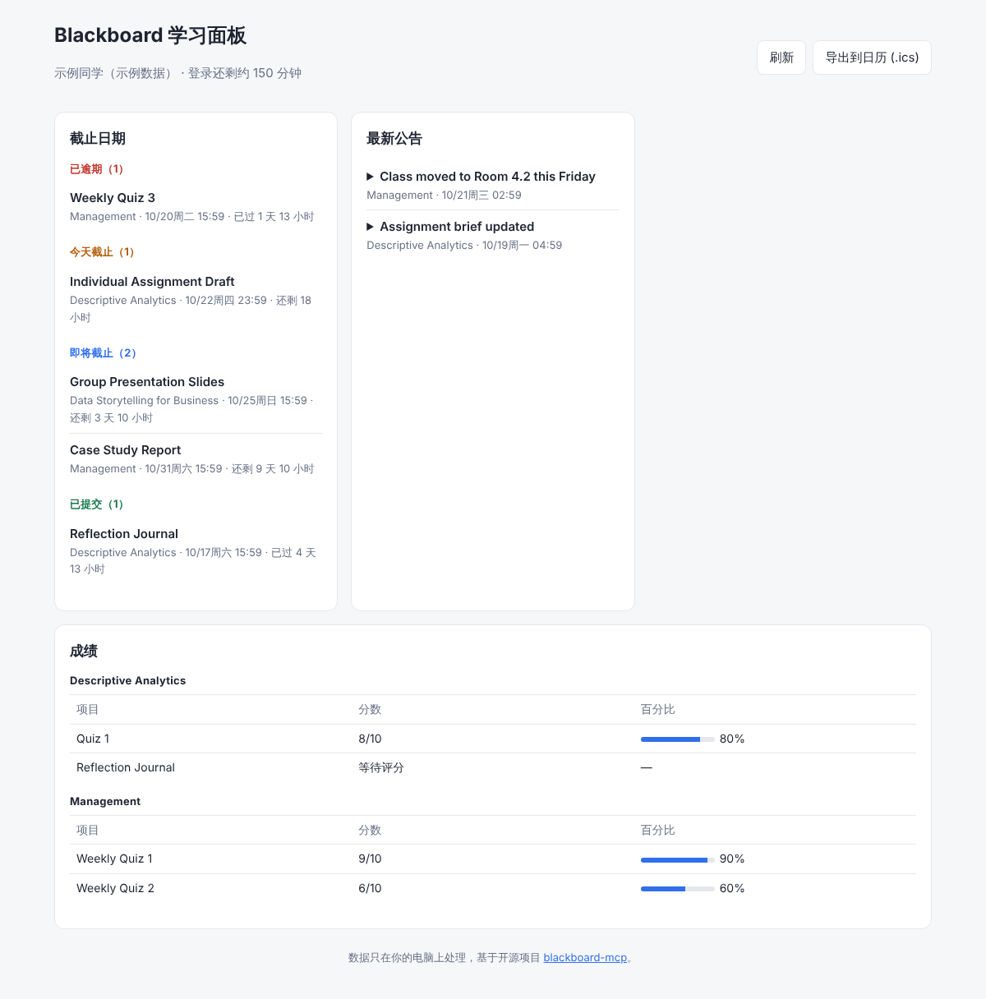
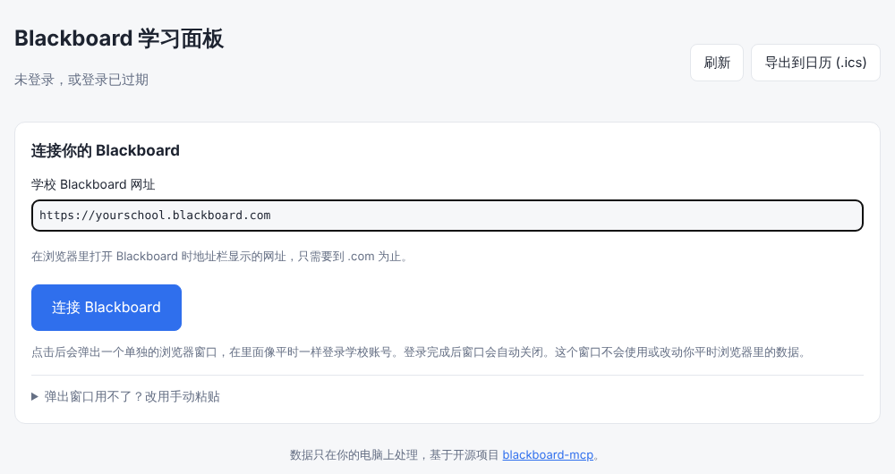
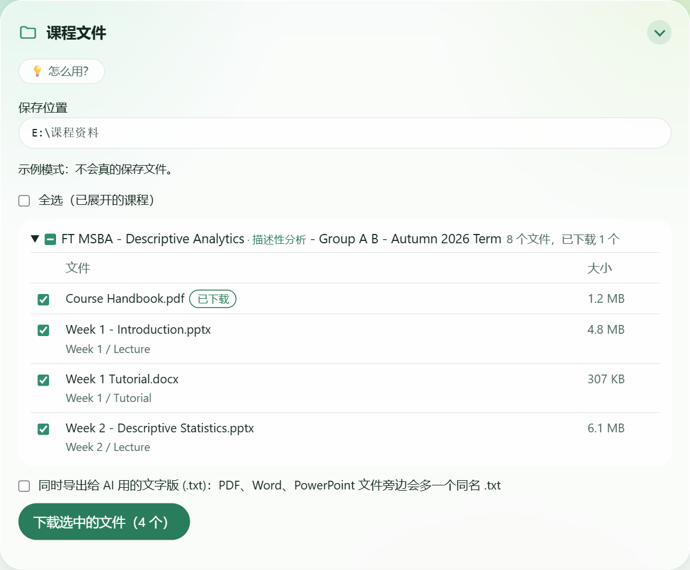

# blackboard-study-hub

**An all-in-one Blackboard hub for international students.** See every deadline, announcement and grade across your courses on one page, and sync deadlines to your calendar. It runs on your own computer, so your login never leaves it.

**面向留学生的 Blackboard 一站式学习平台。** 在一个页面里集中查看所有课程的截止日期、公告和成绩，并把截止日期一键同步到日历，不用再一门一门课点进去找。程序在你自己的电脑上运行，登录信息不会离开你的电脑。



## 新手使用步骤（Windows）

不需要懂代码，按顺序做一次就好。

**1. 下载便携版**
打开 [最新版本下载页](https://github.com/HeathTeng/blackboard-study-hub/releases/latest)，在 **Assets** 下面点 `blackboard-study-hub-版本号-windows.zip` 下载。里面已经带好了运行环境，**不用另外安装任何东西**。

**2. 解压**
右键压缩包，选「全部解压缩」，解压到一个文件夹，比如 `D:\BLACKBOARD` 或你的 U 盘。**一定要先解压**，直接在压缩包里双击是用不了的。

**3. 双击 `start.bat`**
在解压出来的 `blackboard-study-hub` 文件夹里双击 `start.bat`。会出现一个黑色窗口（**不要关掉它**，关掉面板就停了），浏览器会自动打开面板。如果 Windows 提示"已保护你的电脑"，点"更多信息"，再点"仍要运行"。

**4. 连接 Blackboard**
填入你们学校的 Blackboard 网址（浏览器地址栏里到 `.com` 为止的部分），点 **连接 Blackboard**。



**5. 在弹出的窗口里登录学校账号**
像平时一样输入学号和密码。如果学校问 **"保持登录状态？"（Stay signed in?），一定要选"是"**，这样以后打开基本不用再登录。登录完成后窗口会自己关闭，面板显示你的截止日期、公告和成绩。

以后每次使用，只要双击 `start.bat` 就行。想先看看效果，可以双击 `demo.bat`，用的是虚构的示例数据，不需要登录。

### 下载课程文件

在面板最下面的 **课程文件** 里，可以把课件一次性下载到你选的文件夹（比如 U 盘），方便交给 AI 工具或离线复习。

1. 点 **选择文件夹**，选一个保存位置。下次打开会记住。
2. 点课程名展开，勾选要下载的文件；勾课程名前面的方框可以选中这门课的全部文件。
3. 想让 AI 读课件，就勾上 **同时导出给 AI 用的文字版**：每个 PDF、Word、PowerPoint 旁边会多一个同名的 `.txt`。
4. 点 **下载选中的文件**。下载完可以点 **打开文件夹** 查看。

文件会按 `保存位置\课程名\Blackboard 里的文件夹\文件名` 分好类。已经下载过的文件会标 **已下载**，再下载时自动跳过，所以可以放心反复点。



遇到问题请看 **[常见问题](docs/FAQ.md)**。

> 已经装了 Node.js 22.5 以上版本的话，也可以在本页面点绿色的 **Code → Download ZIP** 下载源码版，解压后同样双击 `start.bat` 使用。

---

## Why

Students can't use Blackboard's official API without approval from their school's admin. [blackboard-mcp](https://github.com/felipedias-ie/blackboard-mcp) solves that for AI assistants by reusing your own browser session. blackboard-study-hub builds on its client library and gives you a normal web page instead, with no AI client or terminal needed day to day.

## Roadmap

**Stage 1: easy to start (in progress)**

- [x] One-click sign-in through a pop-up browser window, with silent renewal
- [x] blackboard-mcp bundled in, nothing else to download
- [x] Course file downloader: pick files and a folder (a USB drive works), organised by course, with text exports for AI tools
- [x] Portable zip: download, unzip, double-click, no Node.js install
- [ ] First-run guide, with an FAQ page you can open any time
- [ ] Final README with step-by-step screenshots

**Stage 2: next**

- New UI design and more modules (weekly digest, study packs)
- AI Q&A over your course files, using your own API key

**第一阶段：零门槛上手（进行中）**

- [x] 弹窗一键登录，过期后自动续期
- [x] 内置 blackboard-mcp，不用另外下载
- [x] 课程文件下载器：勾选文件、选择保存位置（可以是 U 盘），按课程整理，可导出给 AI 用的文字版
- [x] 便携压缩包：下载、解压、双击即用，不用装 Node.js
- [ ] 新手引导，常见问题随时可查
- [ ] README 配图版使用说明定稿

**第二阶段：之后**

- 全新界面设计，加入更多模块（每周学习简报、复习资料包）
- 接入 AI，用你自己的 API Key 对课程资料答疑

## Features

- **Deadlines** grouped into overdue, due today, upcoming and submitted, with time left.
- **Announcements** from all open courses, newest first.
- **Grades** per course, with percentages.
- **Calendar export**: download an `.ics` file and import it into Google Calendar, Outlook or Apple Calendar. Each deadline has reminders 1 day and 3 days before.
- **Course file downloader**: pick files course by course and save them to any folder (a USB drive works), organised by course and Blackboard folder. Files already there are skipped, public Google Docs/Slides/Sheets links are saved as PDF, and an optional `.txt` text export of each PDF, Word and PowerPoint file is ready to hand to an AI tool.
- **One-click sign-in**: a pop-up browser window, with your school login remembered and silent renewal.
- **Demo mode** with made-up data, for trying it without an account.

## Requirements

- Node.js 22.5 or newer

blackboard-mcp comes bundled in `vendor/`, so nothing else is needed. To use your own build instead, point `BB_MCP_PATH` at `blackboard-mcp/dist/index.js`, or put a built checkout in a `blackboard-mcp` folder next to this one and run `npm run vendor` to re-bundle it.

## Quick start

**Windows:** download the portable zip from [Releases](https://github.com/HeathTeng/blackboard-study-hub/releases/latest), unzip it and double-click `start.bat`. Node.js is included.

**Command line** (any OS, Node.js 22.5+):

```bash
git clone https://github.com/heathteng/blackboard-study-hub.git
cd blackboard-study-hub
npm start          # or double-click start.bat on Windows
```

Your browser opens at http://localhost:3100. Try it with fake data first with `npm run demo` (or `demo.bat`).

### Signing in

Enter your school's Blackboard address and click **连接 Blackboard**. A separate browser window opens: sign in as you normally do. When you're in, the window closes by itself and your dashboard fills in.

- The window uses its own profile folder (`~/.blackboard-study-hub/browser-profile`), never your everyday browser data.
- It remembers your school login, so next time connecting is usually automatic. If your school's login page asks "Stay signed in?", choose yes.
- While the hub runs it keeps the session alive, and if it lapses it signs back in silently in the background.
- If the pop-up doesn't work, expand "手动粘贴" on the page and paste a "Copy as cURL" instead.
- More help: [FAQ (Chinese)](docs/FAQ.md).

## Privacy and safety

- The server listens on `127.0.0.1` only and rejects requests from other host names or web pages.
- The sign-in window's debugging port listens on `127.0.0.1` only and closes with the window.
- It only **reads** from Blackboard. It cannot submit work or take quizzes.
- Your session is stored encrypted by blackboard-mcp in `~/.blackboard-mcp/`. Never commit that folder or share a copied cURL.
- Check your school's IT acceptable-use policy before using automation tools.

## Development

```bash
npm test
```

To publish a release, push a version tag (for example `git tag v0.2.0 && git push origin v0.2.0`). The Release workflow runs the tests, builds the Windows portable zip with `scripts/build-portable.sh` (the app plus Node.js's `node.exe`, checked against nodejs.org's SHA-256 list) and attaches it to a GitHub Release.

## Credits

- **Author:** [Heath Teng (@HeathTeng)](https://github.com/HeathTeng), who designed and maintains this project, built with help from Claude Code.
- **Built on:** [blackboard-mcp](https://github.com/felipedias-ie/blackboard-mcp) by [Felipe Dias (@felipedias-ie)](https://github.com/felipedias-ie), MIT licensed. Its Blackboard client library does the sign-in and data fetching; thank you, Felipe. `vendor/blackboard-mcp.js` is a bundled build of blackboard-mcp v0.6.0 at commit [`fb05792`](https://github.com/felipedias-ie/blackboard-mcp/commit/fb057928ae200364ac3cda48d10779d33f5a4bb7) with its dependencies, made with `npm run vendor`; its license is in `vendor/LICENSE-blackboard-mcp`, and the licenses of the packages bundled with it are in `vendor/THIRD-PARTY-NOTICES.txt`.

**作者：** 滕泽浩（[@HeathTeng](https://github.com/HeathTeng)），负责项目设计与维护，开发过程中使用了 Claude Code。
**致谢：** 本项目基于 Felipe Dias（[@felipedias-ie](https://github.com/felipedias-ie)）的开源项目 [blackboard-mcp](https://github.com/felipedias-ie/blackboard-mcp)（MIT 许可证）。

## License

MIT
